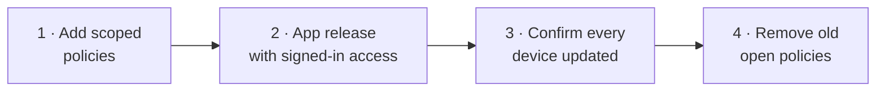

# Database security audit & remediation

**55 production tables moved from blanket access to scoped access, with zero downtime.**

- Audited a live production schema holding payroll and guest data
- Shipped mid-service in four stages, with nobody locked out
- Remaining risks written up, not hidden

> Source is private (live business system). **[Full write-up →](https://sajjad.omni-genai.com/projects/database-security)**

`PostgreSQL` · `Supabase` · `Row-level security` · `SQL migrations` · `SECURITY DEFINER`

<b>How it shipped without downtime</b>

Each stage was safe on its own, so the system stayed up the whole time.

<b>What I delivered</b>

- A full audit of 55 production tables.
- Three migrations covering payroll, operations and rota, and financial, stock and document tables.
- Access rules built on SECURITY DEFINER helper functions.
- A written record of the remaining risks, so the next piece of work starts from a true picture.

---

Built by **[Sajjad Mahessar](https://sajjad.omni-genai.com)** · [LinkedIn](https://www.linkedin.com/in/sajjadmahessar/)
